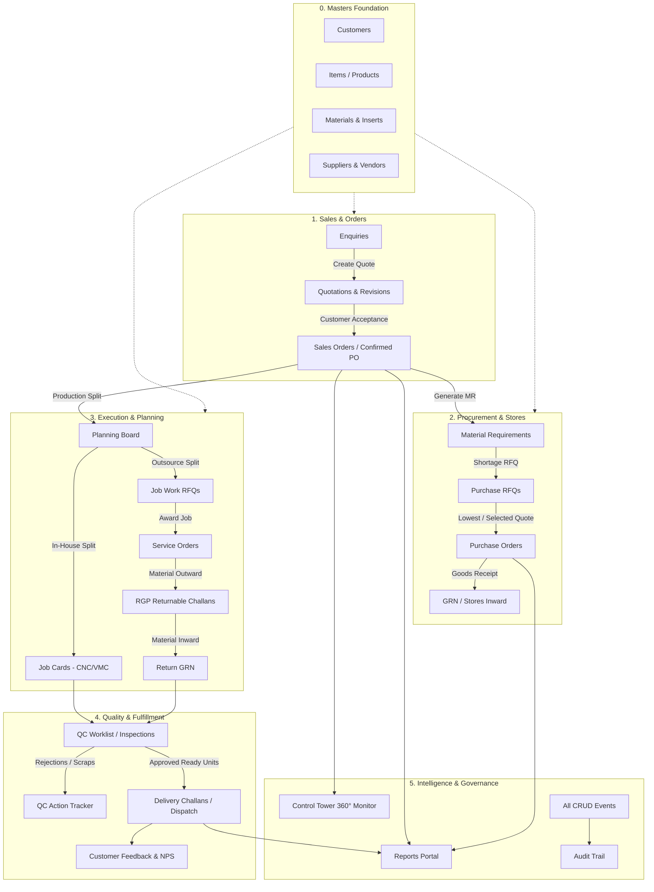

# Custom CRM & Order Management System: Complete Walkthrough & Architecture Guide

> **Application Overview**: Designed specifically for precision manufacturing, tooling, CNC turning, 4/5-axis VMC milling, and die-mould engineering companies. It provides **100% end-to-end traceability**—from the first customer technical enquiry down to procurement, shop-floor job cards, vendor job work, quality control (QC), delivery challans, and customer feedback.

---

## 1. High-Level Data Flow & Architecture

The entire CRM operates on a **Single Source of Truth** with strict **Quantity Reconciliation**:

---

## 2. Module-by-Module Breakdown & Data Connections

Below is the complete reference for all **8 functional sections and 22 tabs** available in the sidebar navigation.

---

### Section I: Masters (The Foundation)
*Everything in the CRM references these 4 master databases. Set these up first.*

#### 1. Customers (`/customers`)
* **Purpose**: Directory of client companies (automotive OEMs, tier-1 suppliers, engineering firms).
* **Key Fields**: Company Name, Contact Person, Phone, Email, GSTIN, Address.
* **Lookups & Downstream Connections**:
  * Linked to `Enquiries.customer_id`
  * Linked to `Quotations.customer_id`
  * Linked to `SalesOrders.customer_id`
  * Linked to `Feedbacks.customer_id`
* **Real-World Example**: *Tata Motors Auto Component Div (Pune)*, *Mahindra Precision & Engine Systems (Chakan)*.

#### 2. Items (`/items`)
* **Purpose**: Catalog of manufactured components, tooling, assemblies, and finished machined products.
* **Key Fields**: Item Name, Unit of Measure (UOM: `Pcs`, `Set`, `Nos`), Default Rate (₹).
* **Lookups & Downstream Connections**:
  * Looked up by `EnquiryItem.item_id`
  * Looked up by `QuotationItem.item_id`
  * Looked up by `SalesOrderItem.item_id`
  * Referenced in `Planning.sales_order_item_id -> item`
* **Real-World Example**: *VMC Milled Bracket Flange (4-Axis)*, *CNC Turned Hardened Bushing (Ø45x80mm)*, *Progressive Die Punch & Matrix Set*.

#### 3. Materials Master (`/materials`)
* **Purpose**: Raw materials, forging billets, bar stocks, plates, hardware, and cutting tools used in production.
* **Key Fields**: Material Name, UOM (`Kg`, `Pcs`, `Mtr`), Available Physical Stock.
* **Lookups & Downstream Connections**:
  * Looked up by `MaterialRequirementItem.material_id`
  * Looked up by `PurchaseRFQItem.material_id`
  * Looked up by `PurchaseOrderItem.material_id`
* **Real-World Example**: *EN8 Round Bar (Ø60mm)*, *EN24 Alloy Steel Block*, *Aluminium 6061-T6 Billet*, *Carbide Inserts CNMG 120408*.

#### 4. Suppliers (`/suppliers`)
* **Purpose**: Raw material distributors, tooling suppliers, and external job work vendors.
* **Key Fields**: Vendor Name, Contact Person, Phone, Email, City.
* **Lookups & Downstream Connections**:
  * Linked to `PurchaseRFQSupplier.supplier_id`
  * Linked to `PurchaseOrder.supplier_id`
  * Linked to `JobWorkRFQSupplier.supplier_id`
  * Linked to `ServiceOrder.supplier_id`
  * Linked to `RGPChallan.vendor_id`
* **Real-World Example**: *Apex Alloy Steels (Bhosari, Pune)*, *Mahalaxmi Vacuum Heat Treaters (Nashik)*, *Shree Balaji Surface Treatment & Hard Chrome*.

---

### Section II: Sales & Orders

#### 5. Enquiries (`/enquiries`)
* **Purpose**: Record incoming requests for quotation (RFQs) and technical enquiries from prospective or existing customers.
* **Key Features**:
  * Follow-up log with next-due dates and communication notes.
  * Status Pipeline: `New` ➔ `Contacted` ➔ `Qualified` ➔ `Quotation Created` ➔ `Lost` / `Closed`.
* **Lookups & Actions**:
  * Lookups: `Customer` (from Customers master), `Item` (from Items master).
  * 1-Click Action: **"Create Quotation"** pushes customer and line-item requirements directly into a draft quotation without re-typing.

#### 6. Quotations (`/quotations`)
* **Purpose**: Commercial pricing proposals with version control, item discounts, and tax breakdowns.
* **Key Features**:
  * **Revision History Engine**: Automatically archives past revisions (`Rev 0`, `Rev 1`, `Rev 2`) as read-only audit records while keeping the latest revision editable.
  * Approval workflow: `Draft` ➔ `Pending Approval` ➔ `Approved` ➔ `Sent` ➔ `Accepted` / `Rejected`.
* **Lookups & Actions**:
  * Lookups: Source `Enquiry` (optional), `Customer`, and `Item` line items.
  * 1-Click Action: **"Convert to Sales Order"** (enabled when status is `Accepted`).

#### 7. Sales Orders (`/sales-orders`)
* **Purpose**: The central contractual transaction of the system. Once customer approval is received, the order is locked for production.
* **Key Features**:
  * Commercial lock: Prevents unauthorized price tampering after confirmation.
  * Quantity tracking per line: `Ordered Qty = Dispatched Qty + Cancelled Qty + Balance Qty`.
  * Dispatch readiness calculator: Shows exactly how many units have passed final QC inspection and are sitting ready in the dispatch bay.
* **Lookups & Actions**:
  * Lookups: `Customer`, source `Quotation`, and `Customer PO Number`.
  * 1-Click Actions:
    1. **"Confirm Order"**: Locks commercial details and records confirmation timestamp.
    2. **"Generate Material Requirement"**: Triggers procurement check.
    3. **"Plan Execution"**: Opens planning board to allocate production.
    4. **"+ Create Dispatch"**: Active when QC-approved units are ready.

---

### Section III: Procurement

#### 8. Material Reqs (`/material-requirements`)
* **Purpose**: Bill-of-Materials (BOM) shortage calculator and stock reservation.
* **Calculation Rule**:
  $$\text{Shortage Qty} = \text{Required Qty} - \text{Available In-Stock Qty}$$
* **Status**: `Draft` ➔ `Checked` ➔ `Approved`.
* **Lookups & Actions**:
  * Lookups: `SalesOrder`, `Customer`, `Material`.
  * Downstream: Generates **Purchase RFQ** for any material lines with $\text{Shortage} > 0$.

#### 9. Purchase RFQs (`/purchase-rfqs`)
* **Purpose**: Requesting competitive quotes from multiple steel/alloy suppliers for raw materials.
* **Key Features**:
  * Side-by-side **Quote Comparison Matrix**: Displays rates, lead times, and total landed cost.
  * Lowest quote highlighting ($\star$ Lowest).
  * Status: `Draft` ➔ `Sent` ➔ `Quotes Received` ➔ `Compared` ➔ `Closed`.
* **Lookups & Actions**:
  * Lookups: Source `MaterialRequirement`, `Materials`, invited `Suppliers`.
  * 1-Click Action: **"Generate PO"** once winning supplier quotes are selected.

#### 10. Purchase Orders (`/purchase-orders`)
* **Purpose**: Formal purchase contracts issued to raw material vendors.
* **Key Features**:
  * Line item quantities, contracted rates (₹), payment terms, and delivery due date.
  * Embedded **Goods Receipt Note (GRN)** creation dialog for recording partial and full material receipts at the store gate.
  * Status: `Issued` ➔ `Partially Received` ➔ `Closed` / `Cancelled`.
* **Lookups & Actions**:
  * Lookups: `Supplier`, source `PurchaseRFQ`, `Materials`.
  * Downstream: Creating a GRN automatically updates `Material.available_stock` in real-time.

---

### Section IV: Execution & Planning

#### 11. Planning (`/plannings`)
* **Purpose**: Production routing. Determines whether an order line is produced in-house on CNC/VMC machines or outsourced to external job work vendors.
* **Split Control**:
  $$\text{Ordered Qty} = \text{In-House Qty} + \text{Outsource Qty}$$
* **Lookups & Actions**:
  * Lookups: `SalesOrderItem` ➔ `Item` and `Customer`.
  * **In-House Split** $\rightarrow$ Creates **Job Card**.
  * **Outsource Split** $\rightarrow$ Creates **Job Work RFQ**.

#### 12. Job Cards (In-House) (`/job-cards`)
* **Purpose**: Shop-floor traveler card assigned to internal CNC lathes, VMCs, and operators.
* **Key Features**:
  * Machine assignment (e.g. *Jyoti VMC-850*, *Ace Micromatic CNC-Turn*).
  * Production entry logging: Operator records `Produced Qty` and `Rejected Qty` per batch/shift.
  * Live visual progress bar (% completed against planned quantity).
  * Status: `Draft` ➔ `Released` ➔ `In Progress` ➔ `Completed` ➔ `Closed`.
* **Lookups & Actions**:
  * Lookups: Source `Planning`, `Item`, `Customer`.
  * Downstream: Completed production entries automatically feed into the **QC Worklist**.

#### 13. Job Work RFQs (`/jobwork-rfqs`)
* **Purpose**: Soliciting process quotations from specialized external job work vendors (e.g., Vacuum Hardening, Hard Chrome Plating, Wire-EDM, Surface Grinding).
* **Key Features**:
  * Material responsibility toggle: *Company Supplied (RGP)* vs *Vendor Supplied*.
  * Multi-vendor quote comparison table with rate per unit (₹) and lead times.
* **Lookups & Actions**:
  * Lookups: Source `Planning`, invited `Suppliers`.
  * 1-Click Action: **"Generate Service Order"** for the selected winning quote.

#### 14. Service Orders (`/service-orders`)
* **Purpose**: Legally binding work order issued to external job work vendors for process execution.
* **Key Features**:
  * Tracks total sent quantity, returned quantity, and open pending units.
  * Status: `Issued` ➔ `Material Sent` ➔ `In Progress` ➔ `Partially Received` ➔ `Completed`.
* **Lookups & Actions**:
  * Lookups: `Supplier`, `JobWorkRFQ`.
  * 1-Click Action: **"Issue RGP Challan"** to send rough parts out to the vendor.

#### 15. RGP Challans (`/rgp-challans`)
* **Purpose**: Returnable Gate Pass (Statutory Document) to track company-owned material moving outside the factory premises for vendor processing.
* **Key Features**:
  * Transporter details, vehicle numbers, challan date, and expected return date.
  * Overdue indicator for material still sitting at vendor locations past the deadline.
  * Inward Return Dialog: Logs received, accepted, and rejected quantities upon return.
* **Lookups & Actions**:
  * Lookups: `ServiceOrder`, `Supplier`.
  * Downstream: Returned quantities route to **QC Inspection** before final acceptance.

---

### Section V: Quality & Fulfillment

#### 16. QC Worklist (`/qc-inspections`)
* **Purpose**: Shop-floor quality assurance station for Incoming, In-Process, and Final inspections.
* **Source Polymorphism**:
  * Inspects parts completed from **Job Cards** (Internal production).
  * Inspects parts returned from **RGP Challans** (External vendor job work).
* **Key Features**:
  * Parameter inspection: Pass / Fail, observed dimensions, hardness readings.
  * Quantity split: $\text{Inspected Qty} = \text{Accepted Qty} + \text{Rejected Qty} + \text{Rework Qty}$.
* **Lookups & Actions**:
  * Lookups: `SalesOrderItem`, source `JobCard` or `RGPChallan`.
  * Downstream: Accepted quantities increment **Available to Dispatch** balance on the Sales Order.

#### 17. QC Action Tracker (`/qc-actions`)
* **Purpose**: Corrective and Preventive Action (CAPA) / Non-Conformance Reports (NCR).
* **Key Features**:
  * Tracks rejected parts assigned to `Scrap`, `Rework`, or `Return to Vendor`.
  * Owner assignment, due date tracking, and closure resolution logs.

#### 18. Delivery Challans / Dispatches (`/dispatches`)
* **Purpose**: Outward dispatch gate pass and shipping manifest.
* **Strict Safety Rule**:
  $$\text{Dispatched Qty} \le \text{QC-Approved Ready Quantity}$$
  *The system physically blocks creating a dispatch for uninspected or unapproved quantities.*
* **Key Features**:
  * Transporter name (e.g. *VRL Logistics*, *TCI Express*), vehicle number, LR/consignment number, package count, and gross weight.
  * Automatic deduction from Sales Order balance.
* **Lookups & Actions**:
  * Lookups: `SalesOrder`, `Customer`.
  * Downstream: Triggers **Customer Feedback** request upon delivery.

---

### Section VI: Intelligence & Analytics

#### 19. Control Tower (`/control-tower`)
* **Purpose**: The 360° Executive Radar. Gives managers single-screen visibility into any order's journey from enquiry to dispatch without opening 10 separate screens.
* **Key Features**:
  * **Order Health Banner**: `GREEN` (On track), `AMBER` (Pending stage / approaching deadline), `RED` (Overdue / blocked).
  * **Visual Stage Progression**:
    $$\text{Enquiry} \rightarrow \text{Quotation} \rightarrow \text{Sales Order} \rightarrow \text{Material} \rightarrow \text{Planning} \rightarrow \text{Production} \rightarrow \text{QC} \rightarrow \text{Dispatch} \rightarrow \text{Feedback}$$
  * Direct deep links to inspect the exact linked document at any stage.

#### 20. Reports Portal (`/reports`)
* **Purpose**: Business intelligence, management summaries, and operational audit reports.
* **Available Reports**:
  1. **Sales Pipeline & Order Ageing**: Revenue, open balance, and overdue days.
  2. **Purchase Summary**: Spend analysis, supplier commitments, and pending GRN units.
  3. **Job Work Ageing & RGP Outstanding**: Company material sitting with outside vendors.
  4. **QC Rejection Analysis**: Rejection rate percentages and top scrap causes.
  5. **Dispatch & Customer Satisfaction**: On-time delivery performance and average ratings.
* **Features**: Live KPI cards, status filters, date range selection, and **Export to CSV**.

#### 21. Customer Feedback (`/feedbacks`)
* **Purpose**: Post-delivery Net Promoter Score (NPS) and satisfaction rating.
* **Key Features**:
  * 1–5 Star rating scale, delivery feedback comments, and issue resolution tracking.
  * Low rating alerts for management follow-up.

---

### Section VII: Admin & Security

#### 22. Admin (`/admin/users`, `/admin/roles`, `/admin/audit-logs`)
* **Users (`/admin/users`)**: User accounts, contact details, active/inactive status toggle, and role assignment.
* **Roles & Permissions (`/admin/roles`)**:
  * Granular Role-Based Access Control (RBAC) matrix across 16 system modules.
  * Controls 6 permission levels: `View`, `Create`, `Edit`, `Approve`, `Delete`, `Export`.
* **Audit Trail (`/admin/audit-logs`)**:
  * Tamper-proof activity ledger documenting every significant event (`create`, `update`, `approve`, `cancel`), who did it, exact timestamp, and serialized JSON diff (`old_values` vs `new_values`).

---

## 3. Quantity Reconciliation Matrix (Summary Table)

| Business Module | Mandatory Reconciliation Formula |
| :--- | :--- |
| **Sales Orders** | $\text{Ordered} = \text{Dispatched} + \text{Cancelled} + \text{Balance}$ |
| **Material Reqs** | $\text{Shortage} = \max(0, \text{Required} - \text{Available Stock})$ |
| **Purchase Orders** | $\text{Ordered} = \text{Received Accepted} + \text{Rejected} + \text{Pending Open}$ |
| **Production Planning** | $\text{Planned Qty} = \text{In-House Batch} + \text{Outsourced Batch}$ |
| **Job Cards** | $\text{Planned} = \text{Produced Accepted} + \text{Tool Scrap / Rejection} + \text{In-Progress}$ |
| **Job Work (RGP)** | $\text{Sent to Vendor} = \text{Returned Accepted} + \text{Rework} + \text{Pending at Vendor}$ |
| **QC Inspections** | $\text{Inspected} = \text{Accepted (Ready to Ship)} + \text{Rejected (Scrap)} + \text{Rework}$ |
| **Delivery Challan** | $\text{Dispatch Qty} \le \text{QC-Approved Units} \text{ and } \le \text{SO Balance}$ |

---

## 4. How to Use the Built-In Product Tour

When you or any team member opens the website for the first time:
1. Click the **"Take Product Tour"** button located at the bottom of the left sidebar.
2. An interactive walkthrough will take you through each module with clear explanations.
3. Use the arrow keys or the **Next / Previous** controls to step through the system.
